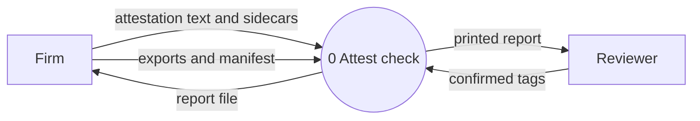
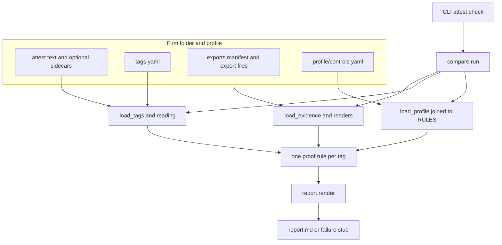

# Architecture of the check

This file is part of the engineering register. A claim here is judged by the code, the tests, and the recorded measurements. It describes the `attest check` command, from the firm folder to `report.md`.

## Level 0 data-flow diagram

The system is one process. The firm and the reviewer are outside it. The control profile and the proof rules are inside the process. Intake is outside too: it writes the text and the sidecar before the check runs, and the check reads what is already in the folder. This diagram has no data stores.

**Attestation text and sidecars.** Files under the firm folder's `attest/`. The insurance application and the written information security plan are UTF-8 text. When intake has already read a PDF or a Word file, a sidecar named like `wisp.txt.map.json` sits beside that text. The check does not call intake. A document with no sidecar is plain text, and the report says so.

**Exports and manifest.** `exports/manifest.yaml` names each file, the reader that parses it, and `exported_at` with a UTC offset. The JSON files are the read-only exports the firm took from Microsoft Graph, Defender for Endpoint, and Veeam. The check parses those files on disk. It does not call Graph, Defender, or Veeam.

**Confirmed tags.** `tags.yaml`. Each tag has `id`, `doc`, `quote`, `control`, and `scope`. A person confirmed them. The check does not invent a tag, and it does not drop a claim that has one.

**Report file.** `report.md` in the firm folder. A successful report begins with `# Attestation check:`. A failed run replaces that file with a stub that begins the same way and says `CHECK FAILED`, so an earlier run's verdicts do not stay looking current. The tool replaces only its own report (a `report.md` that already begins with that title), or writes a new one in a folder that has a `tags.yaml`. Any other file is left alone.

**Printed report.** The same text, written to stdout for the person who ran the check. On an input failure the reason goes to stderr and the process exits 2. A successful check exits 0. An unexpected error writes the same kind of stub and then the traceback still propagates.

## Component diagram

**Attest text and optional sidecars.** The documents tags are allowed to quote. `load_tags` reads the text. `reading.py` reads the sidecar when one is present. A tag that names a `.map.json` file is refused.

**tags.yaml.** The confirmed claims, in order. `load_tags` checks each entry's fields, grounds the quote in its document, and attaches the line span and the source citation.

**Exports manifest and export files.** What `load_evidence` reads. A reader name that appears twice, a file that escapes the exports directory, a missing field, a value of the wrong kind, a duplicate record, or a timestamp without a UTC offset stops the run. The message names the file and the row. Nothing is guessed.

**profile/controls.yaml.** The only list of what a tag may name. It maps a control and a scope to a rule name. It ships with the tool. It is not part of the firm folder.

**CLI attest check.** `attest/__main__.py`. It parses `attest check firm/<name>`, calls `compare.run`, and asks `report.render` for the text. `AttestError` becomes the stub and exit code 2. Any other exception writes the stub and then raises, so the traceback still shows.

**compare.run.** `attest/compare.py`. The whole check in one order: load the profile, load the tags, load the evidence, then call one rule per tag. It returns the tag/verdict pairs and the evidence. It does not group lines and it does not write the file.

**load_profile joined to RULES.** `attest/profile.py` reads the profile. `compare.run` passes `RULES` in, so a control and scope whose rule name has no function stops the run before any tag is judged. A name must be a string that contains a letter or a digit. A control with no scopes stops the run.

**load_tags and reading.** `attest/tags.py` and `attest/reading.py`. The quote must appear exactly once and hold at least three words. The document path must be the one canonical path under `attest/`; another spelling, or a second name for the same file, stops the run. With a sidecar, a hash mismatch, an incomplete reading, a format other than 1, or a damaged sidecar stops the run. A quote on a line the reading will not vouch for refuses that tag. A document with no sidecar is plain text.

**load_evidence and readers.** `attest/evidence.py` walks the manifest. `attest/readers/__init__.py` maps each reader name to a function: `entra_users`, `entra_registration`, `entra_ca_policies`, `entra_security_defaults`, `entra_role_assignments`, `intune_devices`, `defender_machines`, `veeam_users`. Each fact keeps its source as `file:row`. A reader the manifest names that is not in that map stops the run. An export the firm did not supply is an empty field on `Evidence`, and the rule that needed it returns unchecked.

**One proof rule per tag.** The function `RULES` holds for that tag's control and scope, called with the whole `Evidence`. It returns one `Verdict`. Rules live in `attest/rules/mfa.py`, `attest/rules/edr.py`, `attest/rules/backup.py`, and the shared pieces in `attest/rules/common.py`.

**report.render.** `attest/report.py`. It groups tags into attestations, heads each one with the worst status, lists each tag, and appends the export table. A backed verdict with no population is a programming error: `render` raises, and the CLI turns that into a stub rather than a report that says backed without saying who was checked.

**report.md or failure stub.** The CLI writes the text by creating a temporary file in the firm folder, flushing and fsyncing it, then replacing `report.md`. The replace is the publication. A crash before it leaves the previous report, or no report, rather than a half-written one.

## Pipeline order

`compare.run` in `attest/compare.py` does these calls, and no others, before it returns:

1. `load_profile(profile_path, rules=RULES)`
2. `load_tags(firm, profile)`
3. `load_evidence(firm / "exports")`
4. For each tag, in file order: `RULES[profile[tag.control][tag.scope]](evidence)`

A bad tag raises inside step 2, so the exports are not read. A bad export raises inside step 3, so no rule runs. `AttestError` becomes a stub and exit code 2. An unexpected exception writes a stub whose reason starts `internal error:`, then the traceback still propagates.

The engineering register states the same run as four narrative steps: ground the tags, read the exports, apply the rule, group and report. Group and report happen in `report.render` and the CLI, after `compare.run` returns. `load_profile` is the step that narrative folds into the start.

## Types that cross the boundary

Defined in `attest/model.py`, except `Evidence`, which is in `attest/evidence.py`.

- **Tag.** `id`, `doc`, `quote`, `control`, `scope`. Once grounded, `span` (first line, last line, and those whole lines) and `source` (the original file and place, or plain text). `span` and `source` say where the tag is. They take no part in comparing two tags.
- **Export.** `file`, `exported_at`, `items`. One loaded file and the time the firm took it.
- **Evidence.** One optional field per reader. `None` means the firm supplied no export of that kind.
- **Verdict.** `status` (`backed`, `gap`, or `unchecked`), `reason`, `entities` (what failed), `cited` (the rows the verdict rests on), `population` (who was checked). A backed verdict the report will state must carry its population.

## How a rule is chosen

`profile/controls.yaml` maps `control` then `scope` to a rule name. `attest/rules/__init__.py` maps that name to a function. The profile entry `mfa.all_users: mfa_all_users` means a tag with that control and scope calls `mfa.mfa_all_users`. A name in the profile with no function stops the run.

These scopes are rules that return unchecked no matter what was exported, via `never()` in `attest/rules/common.py`:

- `mfa.remote_access`
- `edr.alert_monitoring`
- `backup.m365_files`
- `backup.servers`
- `backup.offline_copy`
- `backup.restore_tested`

They exist so a sentence that mixes a checkable claim with one no export can settle still gets a tag for the second claim. Without that tag, the sentence could come out backed on the first claim alone.

## Fail-closed mechanics

Each item is a path to a false backed that the rules close. The module named is where that decision lives.

- **The population comes from the account list, not from the evidence.** "All users" means every enabled member account in the users export, not every account the registration export happens to mention. A null `userType` is counted. Only an explicit guest is left out. Admins come from the role assignments, not from a field on the registration report. `attest/rules/common.py` (`member_accounts`), `attest/rules/mfa.py`.
- **Anything a rule does not understand narrows.** A Conditional Access policy counts as enforcing MFA only when nothing limits when it applies: no location exception, no device filter, no risk condition, no unknown condition. Recognition is an allow-list, so a new Microsoft condition makes the policy not count. `attest/rules/mfa.py`, `attest/readers/entra_ca_policies.py` (`narrowing_conditions`).
- **"MFA or a compliant device" is not MFA.** A grant that a compliant device satisfies alone does not require MFA. `attest/readers/entra_ca_policies.py` (`requires_mfa`).
- **Exclusions are resolved or presumed.** An excluded group, whose members no export shows, makes the verdict a gap. So does excluding guests in any spelling, or a role held by a principal the exports cannot resolve to accounts. An account the registration export has no row for is missing evidence: unchecked, unless something else already shows a gap. `attest/rules/mfa.py`.
- **Role-targeted policies count only tenant-wide assignments**, matching how Conditional Access evaluates roles scoped to an administrative unit. `attest/rules/mfa.py`.
- **Matching is one-to-one.** Each Intune device pairs with at most one Defender machine. The latest Defender record decides, a tie is a gap, and two different Entra devices are never paired by name. `attest/rules/edr.py`.
- **Evidence outside the population still counts.** A recently seen, unhealthy machine that only Defender knows about makes endpoint protection a gap. Disabled accounts that the backup tool lists join the backup population. Backup rows that match no account are listed. `attest/rules/edr.py`, `attest/rules/backup.py`.
- **Time is checked.** Staleness is measured from `exported_at` in the manifest. A time later than the export time is a gap. Exports a verdict reads that were taken more than 24 hours apart make the verdict unchecked. `attest/rules/common.py` (`exports_apart`).
- **An empty population is unchecked**, not a vacuous backed. `attest/rules/common.py` and the rules that use it.
- **Quote grounding.** The quote appears once, holds at least three words, and the document path is the one canonical path. `attest/tags.py`.
- **Reading refusals.** Edited text (the hash no longer matches; a CRLF checkout still matches), an incomplete reading, a sidecar that is not format 1 or is damaged, OCR, a quoted earlier email, a table row, a line read in a way the tool does not know, a line on a page the reading does not list, or a parse or OCR grade below good or not a grade the tool knows. An absent grade is not a refusal. A document with no sidecar is plain text. `attest/reading.py`.
- **A failed run cannot look like a current report.** The stub, the title check, and the temp-file, fsync, replace write are in `attest/__main__.py`.

## Grouping

`attest/report.py` (`attestations`, `combined_status`). Tags in one document whose quotes touch a common line, directly or through a tag that spans several lines, are one attestation. The join is transitive. Tags in different documents never join, including a copy of a document under another name. The section quotes those whole lines, heads them with the worst status (any gap, else any unchecked, else backed), and lists each tag with its own verdict. The count line counts attestations, not tags.

A sentence wrapped across lines, tagged with one quote per clause, stays split into one attestation per line. A quote that spans the lines keeps them together.

## Outside this process

Intake is a separate package. It writes `attest/*.txt` and the sidecar. `attest check` never calls it.

`truth.yaml` is the dev firm's planted expected verdicts. Tests read it. `attest check` does not.

The private search tool, the one that would quote a firm's own files and refuse when nothing supports an answer, is not a component of this process. It is described as a bet in the strategy register.
