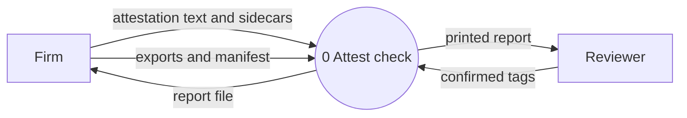
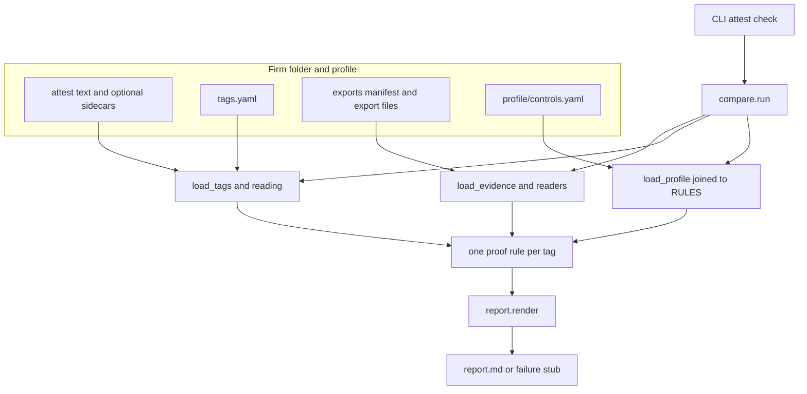

# Pitch README and split registers Implementation Plan

> **For agentic workers:** REQUIRED SUB-SKILL: Use superpowers:subagent-driven-development (recommended) or superpowers:executing-plans to implement this plan task-by-task. Steps use checkbox (`- [ ]`) syntax for tracking.

**Goal:** Make the README a one-sitting account of what attest is and how a check works, and move the three registers into their own directories, with an architecture note that includes a component diagram and a level 0 data-flow diagram.

**Architecture:** Copy the overview's registers into `docs/conceptual/`, `docs/engineering/`, and `docs/strategy/` before replacing the overview with a stub. New prose is the root README, `docs/engineering/architecture.md`, `docs/README.md`, and the stub. Operator detail moves from the root README into `docs/engineering/using.md`. `docs/exports.md` moves beside it. No application code changes.

**Tech Stack:** Markdown, Mermaid, PowerShell for the checks.

## Global Constraints

- The root README is 900 to 1,400 words. Same plain voice as the overview: short sentences, concrete nouns, no pitch-deck language.
- Do not name the partner or her employer.
- Diagrams are Mermaid in `docs/engineering/architecture.md`. No image files.
- The claim "749 automated tests pass" and the date 2026-10-05 are carried as written. Do not re-count tests or present a new measurement.
- Do not edit `docs/superpowers/plans/2026-10-04-attestation-core.md` or `docs/superpowers/plans/2026-10-08-attest-readings.md`. Checking a box in this plan is allowed.
- Do not change application code, tests, or `profile/controls.yaml`.
- Heading numbers from the overview stay (`2.1`, `3.4`, `4.2`).
- Do not create a git commit. The user has not asked for one.
- Tasks 3, 4, and 6 copy from `docs/grounded-assurance-overview.md`. Task 8 replaces that file. Do not run Task 8 before Tasks 3, 4, and 6.

---

### Task 1: Move the export guide and retarget the living spec

**Files:**
- Create: `docs/engineering/exports.md`
- Delete: `docs/exports.md`
- Modify: `docs/superpowers/specs/2026-10-04-attestation-core-design.md` (the sentence that cites `docs/exports.md`)

**Interfaces:**
- Consumes: the current body of `docs/exports.md`
- Produces: `docs/engineering/exports.md` with that body unchanged, so later tasks can link to `exports.md` from inside `docs/engineering/`

- [ ] **Step 1: Copy the file and delete the old path**

Run:

```powershell
New-Item -ItemType Directory -Force -Path docs/engineering | Out-Null
Copy-Item -Path docs/exports.md -Destination docs/engineering/exports.md
Remove-Item -Path docs/exports.md
```

Expected: `docs/engineering/exports.md` exists and `docs/exports.md` does not. The new file's first heading is still `# Producing the exports`.

- [ ] **Step 2: Point the living design spec at the new path**

In `docs/superpowers/specs/2026-10-04-attestation-core-design.md`, replace the single occurrence of `` `docs/exports.md` `` with `` `docs/engineering/exports.md` ``.

The sentence remains: `` `docs/engineering/exports.md` in the repo gives, per reader, the command that produces the export and the documentation page for its fields. ``

- [ ] **Step 3: Check the old path survives only in historical plans**

Run:

```powershell
rg -n "docs/exports.md" -g "!docs/superpowers/plans/**"
```

Expected: no matches. Then:

```powershell
rg -n "docs/exports.md" docs/superpowers/plans
```

Expected: matches still present in the historical plans. Do not edit those files.

### Task 2: Move the operator manual

**Files:**
- Create: `docs/engineering/using.md`
- Read only: `README.md` (do not edit it in this task)

**Interfaces:**
- Consumes: `README.md` from the indented `py -3.12` command block through `## Known limitations`
- Produces: `docs/engineering/using.md`, which Task 6 and the root README link to

- [ ] **Step 1: Write `docs/engineering/using.md`**

The file starts with exactly this header, then a blank line, then the current `README.md` from the line `    py -3.12 -m venv venv` through the end of the file:

```markdown
# Running a check

This is how to run a check.
```

Apply these two replacements to the copied tail, and no others:

1. `` `docs/superpowers/specs/2026-10-04-attestation-core-design.md` `` becomes `` `../superpowers/specs/2026-10-04-attestation-core-design.md` ``.
2. Every `docs/exports.md` becomes `exports.md`. There are two: the "How the firm produces each export" line, and the firm-folder tree line `see docs/exports.md`.

Do not copy the root README's title or its opening paragraph. Those are replaced in Task 9.

- [ ] **Step 2: Check the operator page**

Run:

```powershell
rg -n "docs/exports.md|py -3.12 -m venv venv|Known limitations|../superpowers/specs/2026-10-04-attestation-core-design.md" docs/engineering/using.md
```

Expected: no `docs/exports.md`; the venv line, `Known limitations`, and the `../superpowers/...` design link are all present.

### Task 3: Write the conceptual register

**Files:**
- Create: `docs/conceptual/README.md`
- Read only: `docs/grounded-assurance-overview.md` lines 48–111 and 342–352

**Interfaces:**
- Consumes: overview section 2 (`## 2. Conceptual register` through the end of section 2.6, stopping before the `---` that precedes `## 3.`) and section 5 (`## 5. How the business and the research relate` through the paragraph that ends "the side door into the larger network.")
- Produces: `docs/conceptual/README.md`. The heading `### 2.4 Relatedness is not relation` must remain, so the anchor `#24-relatedness-is-not-relation` resolves.

- [ ] **Step 1: Write the file**

Create `docs/conceptual/README.md`. First lines, exactly:

```markdown
# Conceptual register

This file is the conceptual register. A claim here is an argument about mechanism or values, and it is judged on the merits of the argument.
```

Then a blank line, then overview lines 48–111 verbatim (from `## 2. Conceptual register` through the apophatic-discipline bullet). Then a blank line, then overview lines 342–352 verbatim (from `## 5. How the business and the research relate` through the paragraph ending "the side door into the larger network.").

Do not edit a word of the copied lines. Do not copy section 1, section 3, section 4, section 6, or Sources.

- [ ] **Step 2: Check the heading that other files link to**

Run:

```powershell
rg -n "^### 2.4 Relatedness is not relation$" docs/conceptual/README.md
rg -n "^## 3\.|^## 4\.|^## 6\.|^## Sources" docs/conceptual/README.md
```

Expected: one match for the 2.4 heading. No matches for sections 3, 4, 6, or Sources.

### Task 4: Write the strategy register

**Files:**
- Create: `docs/strategy/README.md`
- Read only: `docs/grounded-assurance-overview.md` lines 247–338 and 356–391

**Interfaces:**
- Consumes: overview section 4, section 6, and Sources
- Produces: `docs/strategy/README.md`. Task 9 links to `#43-sequence` (`## 4.3 Sequence`).

- [ ] **Step 1: Write the file**

Create `docs/strategy/README.md`. First lines, exactly:

```markdown
# Strategy register

This file is the strategy register. A claim here is a bet about buyers, prices, timing, and competitors, stated with its assumption, what would confirm or refute it, and a date.
```

Then a blank line, then overview lines 247–338 verbatim (from `## 4. Strategy register` through the building-sprawl row). Then a blank line, then overview lines 356–391 verbatim (from `## 6. Open questions and next steps` through the last source line). Keep the `## Sources` heading and the sentence that the deadlines, prices, and case law have not been re-checked here.

- [ ] **Step 2: Link the one cross-register citation**

In `docs/strategy/README.md` only, replace this exact sentence fragment:

```markdown
(3.3)
```

in the risks-table row that begins `| Relation judgments |` with:

```markdown
([section 3.3](../engineering/README.md#33-where-the-model-proposes-approach-fails-relations))
```

Do not change any other `(3.3)` that is not in this file. After the edit, that row's middle cell still begins `No local model reliably judges whether two passages relate`.

- [ ] **Step 3: Check the sequence heading and the caveat**

Run:

```powershell
rg -n "^## 4.3 Sequence$|have not been re-checked here|section 3.3" docs/strategy/README.md
```

Expected: the `## 4.3 Sequence` heading, the not-re-checked sentence, and one `section 3.3` link.

### Task 5: Write the architecture note

**Files:**
- Create: `docs/engineering/architecture.md`

**Interfaces:**
- Consumes: the module names and the two Mermaid diagrams in `docs/superpowers/specs/2026-10-09-readme-pitch-and-registers-design.md`
- Produces: `docs/engineering/architecture.md`, linked from the root README and from the engineering register

- [ ] **Step 1: Write `docs/engineering/architecture.md` with this entire body**

````markdown
# Architecture of the check

This file is part of the engineering register. A claim here is judged by the code, the tests, and the recorded measurements. It describes the `attest check` command, from the firm folder to `report.md`.

## Level 0 data-flow diagram

The system is one process. The firm and the reviewer are outside it. The control profile and the proof rules are inside the process. Intake is outside too: it writes the text and the sidecar before the check runs, and the check reads what is already in the folder. This diagram has no data stores.



**Attestation text and sidecars.** Files under the firm folder's `attest/`. The insurance application and the written information security plan are UTF-8 text. When intake has already read a PDF or a Word file, a sidecar named like `wisp.txt.map.json` sits beside that text. The check does not call intake. A document with no sidecar is plain text, and the report says so.

**Exports and manifest.** `exports/manifest.yaml` names each file, the reader that parses it, and `exported_at` with a UTC offset. The JSON files are the read-only exports the firm took from Microsoft Graph, Defender for Endpoint, and Veeam. The check parses those files on disk. It does not call Graph, Defender, or Veeam.

**Confirmed tags.** `tags.yaml`. Each tag has `id`, `doc`, `quote`, `control`, and `scope`. A person confirmed them. The check does not invent a tag, and it does not drop a claim that has one.

**Report file.** `report.md` in the firm folder. A successful report begins with `# Attestation check:`. A failed run replaces that file with a stub that begins the same way and says `CHECK FAILED`, so an earlier run's verdicts do not stay looking current. The tool replaces only its own report (a `report.md` that already begins with that title), or writes a new one in a folder that has a `tags.yaml`. Any other file is left alone.

**Printed report.** The same text, written to stdout for the person who ran the check. On an input failure the reason goes to stderr and the process exits 2. A successful check exits 0. An unexpected error writes the same kind of stub and then the traceback still propagates.

## Component diagram



**Attest text and optional sidecars.** The documents tags are allowed to quote. `load_tags` reads the text. `reading.py` reads the sidecar when one is present. A tag that names a `.map.json` file is refused.

**tags.yaml.** The confirmed claims, in order. `load_tags` checks each entry's fields, grounds the quote in its document, and attaches the line span and the source citation.

**Exports manifest and export files.** What `load_evidence` reads. A reader name that appears twice, a file that escapes the exports directory, a missing field, a value of the wrong kind, a duplicate record, or a timestamp without a UTC offset stops the run. The message names the file and the row. Nothing is guessed.

**profile/controls.yaml.** The only list of what a tag may name. It maps a control and a scope to a rule name. It ships with the tool. It is not part of the firm folder.

**CLI attest check.** `attest/__main__.py`. It parses `attest check firm/<name>`, calls `compare.run`, and asks `report.render` for the text. `AttestError` becomes the stub and exit code 2. Any other exception writes the stub and then raises, so the traceback still shows.

**compare.run.** `attest/compare.py`. The whole check in one order: load the profile, load the tags, load the evidence, then call one rule per tag. It returns the tag/verdict pairs and the evidence. It does not group lines and it does not write the file.

**load_profile joined to RULES.** `attest/profile.py` reads the profile. `compare.run` passes `RULES` in, so a control and scope whose rule name has no function stops the run before any tag is judged. A name must be a string that contains a letter or a digit. A control with no scopes stops the run.

**load_tags and reading.** `attest/tags.py` and `attest/reading.py`. The quote must appear exactly once and hold at least three words. The document path must be the one canonical path under `attest/`; another spelling, or a second name for the same file, stops the run. With a sidecar, a hash mismatch, an incomplete reading, a format other than 1, or a damaged sidecar stops the run. A quote on a line the reading will not vouch for refuses that tag. A document with no sidecar is plain text.

**load_evidence and readers.** `attest/evidence.py` walks the manifest. `attest/readers/__init__.py` maps each reader name to a function: `entra_users`, `entra_registration`, `entra_ca_policies`, `entra_security_defaults`, `entra_role_assignments`, `intune_devices`, `defender_machines`, `veeam_users`. Each fact keeps its source as `file:row`. A reader the manifest names that is not in that map stops the run. An export the firm did not supply is an empty field on `Evidence`, and the rule that needed it returns unchecked.

**One proof rule per tag.** The function `RULES` holds for that tag's control and scope, called with the whole `Evidence`. It returns one `Verdict`. Rules live in `attest/rules/mfa.py`, `attest/rules/edr.py`, `attest/rules/backup.py`, and the shared pieces in `attest/rules/common.py`.

**report.render.** `attest/report.py`. It groups tags into attestations, heads each one with the worst status, lists each tag, and appends the export table. A backed verdict with no population is a programming error: `render` raises, and the CLI turns that into a stub rather than a report that says backed without saying who was checked.

**report.md or failure stub.** The CLI writes the text by creating a temporary file in the firm folder, flushing and fsyncing it, then replacing `report.md`. The replace is the publication. A crash before it leaves the previous report, or no report, rather than a half-written one.

## Pipeline order

`compare.run` in `attest/compare.py` does these calls, and no others, before it returns:

1. `load_profile(profile_path, rules=RULES)`
2. `load_tags(firm, profile)`
3. `load_evidence(firm / "exports")`
4. For each tag, in file order: `RULES[profile[tag.control][tag.scope]](evidence)`

A bad tag raises inside step 2, so the exports are not read. A bad export raises inside step 3, so no rule runs. `AttestError` becomes a stub and exit code 2. An unexpected exception writes a stub whose reason starts `internal error:`, then the traceback still propagates.

The engineering register states the same run as four narrative steps: ground the tags, read the exports, apply the rule, group and report. Group and report happen in `report.render` and the CLI, after `compare.run` returns. `load_profile` is the step that narrative folds into the start.

## Types that cross the boundary

Defined in `attest/model.py`, except `Evidence`, which is in `attest/evidence.py`.

- **Tag.** `id`, `doc`, `quote`, `control`, `scope`. Once grounded, `span` (first line, last line, and those whole lines) and `source` (the original file and place, or plain text). `span` and `source` say where the tag is. They take no part in comparing two tags.
- **Export.** `file`, `exported_at`, `items`. One loaded file and the time the firm took it.
- **Evidence.** One optional field per reader. `None` means the firm supplied no export of that kind.
- **Verdict.** `status` (`backed`, `gap`, or `unchecked`), `reason`, `entities` (what failed), `cited` (the rows the verdict rests on), `population` (who was checked). A backed verdict the report will state must carry its population.

## How a rule is chosen

`profile/controls.yaml` maps `control` then `scope` to a rule name. `attest/rules/__init__.py` maps that name to a function. The profile entry `mfa.all_users: mfa_all_users` means a tag with that control and scope calls `mfa.mfa_all_users`. A name in the profile with no function stops the run.

These scopes are rules that return unchecked no matter what was exported, via `never()` in `attest/rules/common.py`:

- `mfa.remote_access`
- `edr.alert_monitoring`
- `backup.m365_files`
- `backup.servers`
- `backup.offline_copy`
- `backup.restore_tested`

They exist so a sentence that mixes a checkable claim with one no export can settle still gets a tag for the second claim. Without that tag, the sentence could come out backed on the first claim alone.

## Fail-closed mechanics

Each item is a path to a false backed that the rules close. The module named is where that decision lives.

- **The population comes from the account list, not from the evidence.** "All users" means every enabled member account in the users export, not every account the registration export happens to mention. A null `userType` is counted. Only an explicit guest is left out. Admins come from the role assignments, not from a field on the registration report. `attest/rules/common.py` (`member_accounts`), `attest/rules/mfa.py`.
- **Anything a rule does not understand narrows.** A Conditional Access policy counts as enforcing MFA only when nothing limits when it applies: no location exception, no device filter, no risk condition, no unknown condition. Recognition is an allow-list, so a new Microsoft condition makes the policy not count. `attest/rules/mfa.py`, `attest/readers/entra_ca_policies.py` (`narrowing_conditions`).
- **"MFA or a compliant device" is not MFA.** A grant that a compliant device satisfies alone does not require MFA. `attest/readers/entra_ca_policies.py` (`requires_mfa`).
- **Exclusions are resolved or presumed.** An excluded group, whose members no export shows, makes the verdict a gap. So does excluding guests in any spelling, or a role held by a principal the exports cannot resolve to accounts. An account the registration export has no row for is missing evidence: unchecked, unless something else already shows a gap. `attest/rules/mfa.py`.
- **Role-targeted policies count only tenant-wide assignments**, matching how Conditional Access evaluates roles scoped to an administrative unit. `attest/rules/mfa.py`.
- **Matching is one-to-one.** Each Intune device pairs with at most one Defender machine. The latest Defender record decides, a tie is a gap, and two different Entra devices are never paired by name. `attest/rules/edr.py`.
- **Evidence outside the population still counts.** A recently seen, unhealthy machine that only Defender knows about makes endpoint protection a gap. Disabled accounts that the backup tool lists join the backup population. Backup rows that match no account are listed. `attest/rules/edr.py`, `attest/rules/backup.py`.
- **Time is checked.** Staleness is measured from `exported_at` in the manifest. A time later than the export time is a gap. Exports a verdict reads that were taken more than 24 hours apart make the verdict unchecked. `attest/rules/common.py` (`exports_apart`).
- **An empty population is unchecked**, not a vacuous backed. `attest/rules/common.py` and the rules that use it.
- **Quote grounding.** The quote appears once, holds at least three words, and the document path is the one canonical path. `attest/tags.py`.
- **Reading refusals.** Edited text (the hash no longer matches; a CRLF checkout still matches), an incomplete reading, a sidecar that is not format 1 or is damaged, OCR, a quoted earlier email, a table row, a line read in a way the tool does not know, a line on a page the reading does not list, or a parse or OCR grade below good or not a grade the tool knows. An absent grade is not a refusal. A document with no sidecar is plain text. `attest/reading.py`.
- **A failed run cannot look like a current report.** The stub, the title check, and the temp-file, fsync, replace write are in `attest/__main__.py`.

## Grouping

`attest/report.py` (`attestations`, `combined_status`). Tags in one document whose quotes touch a common line, directly or through a tag that spans several lines, are one attestation. The join is transitive. Tags in different documents never join, including a copy of a document under another name. The section quotes those whole lines, heads them with the worst status (any gap, else any unchecked, else backed), and lists each tag with its own verdict. The count line counts attestations, not tags.

A sentence wrapped across lines, tagged with one quote per clause, stays split into one attestation per line. A quote that spans the lines keeps them together.

## Outside this process

Intake is a separate package. It writes `attest/*.txt` and the sidecar. `attest check` never calls it.

`truth.yaml` is the dev firm's planted expected verdicts. Tests read it. `attest check` does not.

The private search tool, the one that would quote a firm's own files and refuse when nothing supports an answer, is not a component of this process. It is described as a bet in the strategy register.
````

- [ ] **Step 2: Check both diagrams and the module names**

Run:

```powershell
rg -n "flowchart LR|flowchart TB|CHECK FAILED|load_profile|member_accounts|requires_mfa|never\(" docs/engineering/architecture.md
```

Expected: one `flowchart LR`, one `flowchart TB`, and a hit for each of the other terms. The file contains no image link (`.

### Task 6: Write the engineering register

**Files:**
- Create: `docs/engineering/README.md`
- Read only: `docs/grounded-assurance-overview.md` lines 115–243

**Interfaces:**
- Consumes: overview section 3, plus `using.md`, `exports.md`, and `architecture.md` from earlier tasks
- Produces: `docs/engineering/README.md`. The heading `### 3.4 attest: the deterministic attestation check` must remain, so `#34-attest-the-deterministic-attestation-check` resolves. The heading `### 3.3 Where the model-proposes approach fails: relations` must remain, so the strategy register's link resolves.

- [ ] **Step 1: Write the file from section 3**

Create `docs/engineering/README.md`. First lines, exactly:

```markdown
# Engineering register

This file is the engineering register. A claim here is a statement about what is built and what was measured, and it is judged by the code, the tests, and the recorded measurements. Unmeasured means unmeasured.
```

Then a blank line, then overview lines 115–243 verbatim (from `## 3. Engineering register` through the bullet that the node belongs in the firm's own WISP and insurance application).

- [ ] **Step 2: Point section 2.4 at the conceptual register**

In this file only, replace the exact fragment `(2.4)` in the paragraph that ends "This is why the check does not pair claims with evidence through a model at all (2.4)." with:

```markdown
([section 2.4](../conceptual/README.md#24-relatedness-is-not-relation))
```

Leave `(3.3)` in the section 3.1 table and `(3.2)` in the section 3.5 table as plain text. Those headings are in this same file.

- [ ] **Step 3: Replace the fail-closed list and the known-limits list**

In section 3.4, delete from the line `**How the proof rules fail closed.**` through the last known-limits bullet (the Veeam field-names bullet), stopping before `### 3.5 What the node still lacks`. Put this in its place. Keep the three measured-state bullets byte for byte, including `749 automated tests pass` and `2 backed, 6 gap, 4 unchecked`.

```markdown
**How the proof rules fail closed.** The principles, and the module that implements each one, are in [architecture.md](architecture.md).

How to run a check is in [using.md](using.md). How the firm produces each export is in [exports.md](exports.md).

**Measured state (2026-10-05):**

- 749 automated tests pass. Two symlink tests need one run on a machine that permits symlinks.
- A made-up firm with planted truth (Microsoft 365 Business Premium plus Veeam) comes out **2 backed, 6 gap, 4 unchecked**, with **no false "backed"**. Its "healed" variant, and mutations of it that each break one thing, are tested end to end.
- The code went through task-by-task review and then four rounds of independent whole-branch review. Each round found and closed paths to a false "backed", from policies whose exclusions were spelled in unexpected ways to clause-level tags that let half of a compound sentence pass on its own.

**Known limits.** The limits stated for operators are in [using.md](using.md#known-limitations).
```

The four pipeline steps above that replacement stay: ground the tags, read the exports, apply the scope's proof rule, group and report.

- [ ] **Step 4: Check the cut**

Run:

```powershell
rg -n "How the proof rules fail closed|749 automated tests pass|Known limits|architecture.md|The population never comes from the evidence" docs/engineering/README.md
```

Expected: hits for the pointer sentence, `749 automated tests pass`, and `Known limits`. No hit for `The population never comes from the evidence` (that list now lives only in `architecture.md`).

### Task 7: Write the map

**Files:**
- Create: `docs/README.md`

**Interfaces:**
- Consumes: the three register paths and the three engineering companions
- Produces: `docs/README.md`, linked from the root README

- [ ] **Step 1: Write `docs/README.md` with this entire body**

```markdown
# Registers

A conceptual claim is judged on the argument. An engineering claim is judged by the code, the tests, and the recorded measurements; unmeasured means unmeasured. A strategy claim is a bet about buyers, prices, timing, and competitors, stated with its assumption, what would confirm or refute it, and a date. A strategy bet does not borrow the authority of a measurement, and a concept is not presented as something already built.

- [Conceptual register](conceptual/README.md). Why a model does not decide whether a sentence and an export row agree.
- [Engineering register](engineering/README.md). What is built and what was measured.
  - [Running a check](engineering/using.md)
  - [Producing the exports](engineering/exports.md)
  - [Architecture of the check](engineering/architecture.md)
- [Strategy register](strategy/README.md). Who would pay, the prices, the sequence, and the risks, each written as a bet.

The repository README is the account of what attest is and how a check works.
```

- [ ] **Step 2: Check the links point at files that exist**

Run:

```powershell
@(
  "docs/conceptual/README.md",
  "docs/engineering/README.md",
  "docs/engineering/using.md",
  "docs/engineering/exports.md",
  "docs/engineering/architecture.md",
  "docs/strategy/README.md"
) | ForEach-Object { if (-not (Test-Path $_)) { Write-Output "MISSING $_" } }
```

Expected: no `MISSING` lines.

### Task 8: Replace the overview with a stub

**Files:**
- Modify: `docs/grounded-assurance-overview.md` (replace the whole file)

**Interfaces:**
- Consumes: nothing from the old body. Tasks 3, 4, and 6 have already copied it.
- Produces: a stub that keeps the title, the date line, and the companion sentence

- [ ] **Step 1: Confirm the copies exist before deleting the body**

Run:

```powershell
rg -n "^## 2. Conceptual register$" docs/conceptual/README.md
rg -n "^## 3. Engineering register$" docs/engineering/README.md
rg -n "^## 4. Strategy register$" docs/strategy/README.md
rg -n "^## 5. How the business and the research relate$" docs/conceptual/README.md
rg -n "^## 6. Open questions and next steps$" docs/strategy/README.md
rg -n "^## Sources$" docs/strategy/README.md
```

Expected: one match each. If any command prints nothing, stop. Do not overwrite the overview.

- [ ] **Step 2: Replace `docs/grounded-assurance-overview.md` with this entire body**

```markdown
# Grounded assurance for small professional firms

**Concept, engineering and strategy** · 2026-10-05 · companion to the business-model document

The three registers live in [docs/conceptual/](conceptual/README.md), [docs/engineering/](engineering/README.md), and [docs/strategy/](strategy/README.md). The repository README is the account of what attest is and how a check works. [docs/README.md](README.md) is the map.
```

- [ ] **Step 3: Check the old sections are gone from this path**

Run:

```powershell
rg -n "^## 2. Conceptual register$|^## 4. Strategy register$|Travelers" docs/grounded-assurance-overview.md
```

Expected: no matches.

### Task 9: Replace the root README

**Files:**
- Modify: `README.md` (replace the whole file)

**Interfaces:**
- Consumes: links to `docs/engineering/architecture.md`, `docs/engineering/README.md#34-attest-the-deterministic-attestation-check`, `docs/strategy/README.md#43-sequence`, `docs/conceptual/README.md`, `docs/engineering/using.md`, `docs/engineering/exports.md`, `docs/README.md`
- Produces: the pitch README. It contains no install commands and no tag schema.

- [ ] **Step 1: Replace `README.md` with this entire body**

```markdown
# attest

Attest checks a small firm's insurance application and its written information security plan against read-only exports from Microsoft 365 and Veeam. Each claim comes out **backed**, **gap**, or **unchecked**, and the report cites the export rows it rests on.

The check runs on a folder on disk. It reads the firm's text and exports and writes `report.md`. It makes no network call.

## What it is for

Accounting and tax practices, law offices, and wealth advisors sign statements about their own security every year. A cyber insurance application asks what is in place. A tax preparer is required to keep a written information security plan. An answer that is wrong can void the policy the firm is counting on.

In *Travelers v. ICS* (2022), the application said multi-factor login was used everywhere. It was only on the firewall. After a ransomware attack, the insurer had the policy rescinded.

The firm already has to have the plan. The product is the verification of that plan and of the insurance application, sentence by sentence, against the systems the firm already runs.

## The three answers

- **Backed.** The exports show the claim holds for the whole population it names.
- **Gap.** The exports show a failure, and they name who or what failed.
- **Unchecked.** The exports in hand do not settle the claim. Unchecked is a finding. It means the evidence does not settle it.

A false backed tells a firm it may sign something the exports do not support. That is the error the rules are built to refuse. A false gap costs a reviewer a few minutes to annotate a known exception. Missing evidence is unchecked. A shown failure is a gap. Backed requires proof that covers the whole claim.

## How a check works

The firm's sentences go in as plain text: the application and the written plan.

The exports go in beside them. The firm runs them read-only while the reviewer watches, and the check never holds admin credentials. The exports are the user list, MFA registration, Conditional Access policies, security defaults, directory role assignments, Intune devices, Defender for Endpoint machines, and Veeam's mailbox backup report. A manifest names each file, the reader that parses it, and the UTC time it was taken.

Tags a person has confirmed go in next. Each tag quotes one claim and names the control and the scope that claim is about. The scopes a current export can back are MFA for all users, for email, and for admins; endpoint protection for all endpoints; and backup of Microsoft 365 mailboxes. Remote-access MFA, alert monitoring, Microsoft 365 file backup, server backup, an offline copy, and a tested restore are tagged too, and they come out unchecked, because no export in this set speaks to them. A model may later suggest a tag. A person confirms it. A rule decides the verdict.

The rule for that control and scope compares the claim to the exports. The population comes from the account list or the device list, not from whoever happened to show up in the evidence file. A Conditional Access policy the rule does not fully understand does not count as proof.

One sentence shows why the unchecked scopes exist. "Every company laptop runs Microsoft Defender for Business, which is monitored for alerts." That is two claims. Laptop coverage can be backed or a gap, from the Intune device list joined to the Defender machine list. Alert monitoring is unchecked, because no export shows that anyone watches the alerts. A tag on only the Defender half would let the sentence come out backed, with the monitoring claim never tested.

The report quotes the lines those tags touch. It heads them with the worst verdict on that passage: any gap, else any unchecked, else backed. Under the quotation it lists each tag with its own verdict and the cited rows.

The mechanics, the component diagram, and the level 0 data-flow diagram are in [the architecture note](docs/engineering/architecture.md).

## What is built

The check is built. Readers turn each export into facts and keep each fact's row. Proof rules produce the verdict. The report groups claims that share a line. A made-up firm with planted truth is checked end to end, and the review of the rules was aimed at paths to a false backed. The measured state, with its test count and its date, is in the [engineering register](docs/engineering/README.md#34-attest-the-deterministic-attestation-check).

What comes after the check is a bet, and it is not running. It is a private search tool over the firm's own files: every answer quotes a source, and when nothing supports an answer the tool refuses. The commitment that bet is meant to keep is that a firm's data does not train a model used by another firm. Reading the firm's files, walls between clients, and a staff client are not built. The sequence, the check first and that tool only after paid checks, is in the [strategy register](docs/strategy/README.md#43-sequence).

## Where the rest is

Three registers sit beside this account. A conceptual claim is judged on the argument. An engineering claim is judged by the code, the tests, and the recorded measurements. A strategy claim is a bet, with its assumption and what would confirm or refute it. A bet does not borrow the authority of a measurement.

- **[Conceptual](docs/conceptual/README.md).** Why two passages about the same thing are not yet a relation, and why a model does not decide whether a sentence and an export row agree.
- **[Engineering](docs/engineering/README.md).** What is built and what was measured, [how to run a check](docs/engineering/using.md), [how the firm produces each export](docs/engineering/exports.md), and the [architecture](docs/engineering/architecture.md) of the check.
- **[Strategy](docs/strategy/README.md).** Who would pay, the prices, the sequence, and the risks. Each one is written as a bet.

The map of those files is [docs/README.md](docs/README.md).
```

- [ ] **Step 2: Count words and confirm the operator manual is gone**

Run:

```powershell
$n = (Get-Content -Raw README.md) -split '\s+' | Where-Object { $_ -ne '' } | Measure-Object | Select-Object -ExpandProperty Count
Write-Output "words $n"
rg -n "py -3.12|tags.yaml|CHECK FAILED|Known limitations" README.md
```

Expected: `words` between 900 and 1400 inclusive. No matches for the operator terms.

### Task 10: Verify the set

**Files:**
- Modify: `docs/superpowers/specs/2026-10-09-readme-pitch-and-registers-design.md` (status line only)

**Interfaces:**
- Consumes: every file the earlier tasks produced
- Produces: a status line of `Approved`, and a passing check

- [ ] **Step 1: Mark the spec approved**

In `docs/superpowers/specs/2026-10-09-readme-pitch-and-registers-design.md`, replace `**Status:** Draft for review` with `**Status:** Approved`.

- [ ] **Step 2: Run the set check**

```powershell
rg -n "docs/exports.md" -g "!docs/superpowers/plans/**"
rg -n "EDGE|girlfriend" README.md docs/conceptual docs/engineering docs/strategy docs/README.md docs/grounded-assurance-overview.md
rg -n "flowchart LR" docs/engineering/architecture.md
rg -n "flowchart TB" docs/engineering/architecture.md
if (Test-Path docs/exports.md) { Write-Output "OLD EXPORTS STILL PRESENT" }
```

Expected: no matches from the first two searches, one match each for the two flowcharts, and no `OLD EXPORTS STILL PRESENT`.

```powershell
rg -n "docs/exports.md" docs/superpowers/plans
```

Expected: matches still present. Those files were not edited by this plan, other than this plan file itself, which must not contain an instruction that rewrites them. A match inside this plan file is the verification command above; that is fine. Matches inside `2026-10-04-attestation-core.md` and `2026-10-08-attest-readings.md` must still be there.
