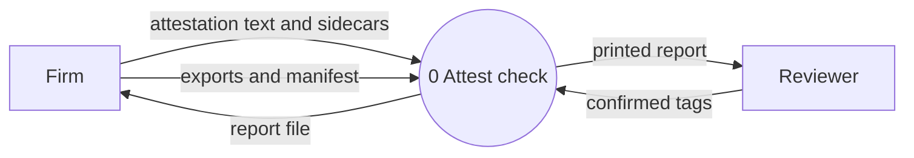
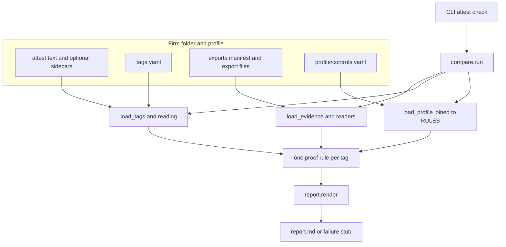

# Spec: pitch README, split registers, architecture note

**Date:** 2026-10-09
**Status:** Approved
**Repo:** attest

## Problem

The repository README is the operator manual: folder layout, the tag schema, intake refusals, exit codes, and known limits. The idea, what is built, and the commercial bets live together in `docs/grounded-assurance-overview.md`, which keeps three registers apart and says so. Neither file is something to hand a future business partner while talking, or to leave with her instead of talking.

She is a security engineer. The document she reads first has to assume MFA, Conditional Access, endpoint protection, backup, and an insurance application, and it has to define only attest's own terms. Her name and her employer do not appear.

## Goal

1. The README explains what attest is, what it is for, and how a check works, in one sitting.
2. The conceptual, engineering, and strategy registers each live in their own directory under `docs/`.
3. `docs/engineering/architecture.md` goes into the mechanics of the check and carries two diagrams: a component diagram, and a level 0 data-flow diagram.

## Decisions

- **Recommended shape, approved 2026-10-09.** The README is a single sitting of plain prose. Headings are also usable one at a time while talking. Commercial bets and the research argument stay in their registers. The ending points at each register in one sentence.
- **Audience, approved 2026-10-09.** A future business partner who is a security engineer. Precise about the check. No glossary for MFA, Conditional Access, Defender, or backup.
- **Added 2026-10-09.** An architecture note with a component diagram and a level 0 DFD, under the engineering register.
- **Diagrams are Mermaid** in `architecture.md`. No image files.
- **One home for the proof-rule catalog.** The fail-closed principles now in overview section 3.4 move into `architecture.md`, each one naming the module that implements it. The engineering register keeps the inputs, the control table, and the dated measured state, and points at the architecture note for the mechanics.
- **Measured claims stay dated.** The "749 tests, 2026-10-05" claim is carried as written. This change does not re-count tests or present a new measurement.
- **Historical plans stay historical.** `docs/superpowers/plans/` keeps the paths it recorded, including `docs/exports.md`. The living design spec `docs/superpowers/specs/2026-10-04-attestation-core-design.md` is updated where it points at `docs/exports.md`, because that pointer is how a reader finds the file.
- **The overview file becomes a stub.** `docs/grounded-assurance-overview.md` keeps its title, date, and companion note, and points at the three directories and the README. The body is not left in place beside the split.

## README

Replace `README.md`. About 900 to 1,400 words. Same plain voice as the overview: short sentences, concrete nouns, no pitch-deck language. Do not name the partner or her employer.

Sections, in this order:

1. **What it is.** Attest checks a small firm's insurance application and written information security plan against read-only exports from Microsoft 365 and Veeam. Each claim comes out backed, gap, or unchecked, and the report cites the export rows. The check runs on a local firm folder. It reads those files and writes `report.md`. The code makes no network call.
2. **What it is for.** Accounting and tax practices, law offices, and wealth advisors sign those statements every year. A wrong answer can void the policy they are counting on. One sentence on *Travelers v. ICS* (2022), as the overview states it: the application said multi-factor login was used everywhere, it was only on the firewall, and the insurer had the policy rescinded after ransomware. The firm already has to have the plan. The product is the verification. The case-law source and the "not re-checked here" caveat stay with the strategy register; the README names the case and does not add a new citation.
3. **The three answers.** Backed: the exports show the claim holds for the whole population it names. Gap: the exports show a failure, and name it. Unchecked: the exports do not settle it. A false backed is the error the rules are built to refuse. A false gap costs a reviewer a few minutes. Missing evidence is unchecked.
4. **How a check works.** Four inputs, then a report.
   - The firm's sentences, as text.
   - Read-only exports the firm runs while the reviewer watches: users, MFA registration, Conditional Access, security defaults, role assignments, Intune devices, Defender machines, Veeam mailbox backups. The check never holds admin credentials.
   - Tags a person confirms. Each tag quotes one claim and names a control and a scope. A model may later suggest tags. A person confirms. A rule decides.
   - A fixed rule for that pair compares the claim to the exports. The population comes from the account or device list. A policy the rule does not fully understand does not count as proof.
   - The Defender example, kept concrete: "Every company laptop runs Microsoft Defender for Business, which is monitored for alerts." Coverage can be backed or a gap from the Intune and Defender exports. Alert monitoring is unchecked, because no export shows that anyone watches the alerts. A tag on only the Defender half would let the sentence come out backed.
   - The report quotes the lines, heads them with the worst verdict on that passage (any gap, else any unchecked, else backed), and lists each tag with its own verdict and the cited rows.
   - Last sentence of this section links to `docs/engineering/architecture.md`.
5. **What is built.** The check is built: readers, proof rules, the report, a made-up firm with planted truth, and review aimed at paths to a false backed. State that as the engineering register's dated claim, and link there for the number and the date. The later product, a private search tool that quotes the firm's own files and refuses when nothing supports an answer, is one paragraph, labeled as a bet that waits on paid checks. That paragraph states the commitment the node is meant to keep: a firm's data does not train a model used by another firm. File reading, permissions, and a staff client are not built. Link to the strategy register for the sequence.
6. **Where the rest is.** One sentence each:
   - Conceptual: why a model does not decide whether a sentence and an export row agree.
   - Engineering: what was measured, how to run a check, how exports are produced, and the architecture note.
   - Strategy: who would pay, the prices, the sequence, and the risks, each written as a bet.

The README does not include install commands, the tag schema, exit codes, or the proof-rule catalog.

## Registers

`docs/README.md` is a short map. It restates the overview's reading rule in one paragraph: a conceptual claim is judged on the argument, an engineering claim on the code, the tests, and the recorded measurements, and a strategy claim is a bet with an assumption and what would confirm or refute it. Then three links, and under engineering the links to `using.md`, `exports.md`, and `architecture.md`.

Each register file opens with one sentence naming its register and how a claim in it is judged. Heading numbers from the overview stay as they are (`2.1`, `3.4`, `4.2`), so a cross-reference can link to the same heading. "Section 2.4" in another file becomes a link to that heading, and the visible words can stay "section 2.4".

The engineering register's four pipeline steps stay the short narrative (ground the tags, read the exports, apply the rule, group and report). `architecture.md` is the call order, which starts one step earlier with `load_profile`. Those two accounts describe the same run.

### `docs/conceptual/README.md`

Moved from the overview, prose unchanged except cross-references:

- Section 2, "Conceptual register" (2.1 through 2.6).
- Section 5, "How the business and the research relate."

### `docs/engineering/README.md`

Moved from the overview, prose unchanged except the edits below:

- Section 3, "Engineering register" (3.1 through 3.6).
- Section 3.4 keeps: what goes in, the export table, the control table, the pipeline in four short steps, the measured state with its date, and the known limits as a pointer to `using.md`.
- Section 3.4 drops the long "How the proof rules fail closed" list. In its place, one paragraph points at `architecture.md`.
- A pointer to `using.md` and `exports.md` sits with 3.4.
- Internal "section 2.4" and similar cross-register pointers become links to the conceptual file's headings. Pointers that stay inside section 3 stay as headings in this file.

### `docs/engineering/using.md`

The current README from the firm-folder tree through "Known limitations," plus the four command lines (venv, pip, pytest, `attest check`). Opening sentence: this is how to run a check. Link `docs/exports.md` references to `exports.md` beside this file. Link the 2026-10-04 design spec here, not from the pitch README.

### `docs/engineering/exports.md`

Move `docs/exports.md` here. Body unchanged. Delete the old path.

### `docs/engineering/architecture.md`

Written new, for the same reader as the README, at the depth of the modules. She can follow a check from the firm folder to `report.md` without opening the Python. This file does not paste rule source and does not restate the strategy bets.

Required sections:

1. **Level 0 DFD**, the Mermaid diagram specified below, then a short reading of each flow: what the bytes are, and that a failed run's report is a stub that begins with the report title and says `CHECK FAILED`.
2. **Component diagram**, the Mermaid diagram specified below, then one paragraph per node saying what it does and what it refuses.
3. **Pipeline order**, matching `attest/compare.py`: `load_profile` (joined to `RULES`), then `load_tags`, then `load_evidence`, then one rule call per tag. A bad tag stops the run before exports are read. `AttestError` becomes a stub and exit code 2. An unexpected exception writes the same kind of stub, then the traceback still propagates.
4. **Types that cross the boundary:** `Tag` (id, doc, quote, control, scope, span, source), `Export` (file, exported_at, items), `Evidence` (one optional field per reader), `Verdict` (status, reason, entities, cited, population). A backed verdict the report will state must carry its population.
5. **How a rule is chosen.** `profile/controls.yaml` maps control and scope to a rule name. `attest/rules/__init__.py` maps that name to a function. A profile name with no function stops the run. The always-unchecked scopes are rules that return unchecked (`mfa.remote_access`, `edr.alert_monitoring`, `backup.m365_files`, `backup.servers`, `backup.offline_copy`, `backup.restore_tested`).
6. **Fail-closed mechanics**, the list now in overview 3.4, each bullet naming its module:
   - Population comes from the users export (or role assignments for admins), not from the evidence export. `rules/common.py`, `rules/mfa.py`.
   - A Conditional Access policy counts only when nothing the rule does not understand narrows it. Recognition is an allow-list. `rules/mfa.py`, `readers/entra_ca_policies.py`.
   - "MFA or a compliant device" is not MFA. `readers/entra_ca_policies.py` (`requires_mfa`).
   - An excluded group, an unresolved role, or guests excluded in any spelling is a gap. `rules/mfa.py`.
   - Role-targeted policies count only tenant-wide assignments. `rules/mfa.py`.
   - Intune-to-Defender pairing is one-to-one; the latest Defender record decides; a tie is a gap. `rules/edr.py`.
   - A machine only Defender knows about can still make endpoint protection a gap. Disabled accounts the backup tool lists join the backup population. `rules/edr.py`, `rules/backup.py`.
   - Staleness is measured from `exported_at`. A time later than the export is a gap. Exports more than 24 hours apart make the verdict unchecked. `rules/common.py`.
   - An empty population is unchecked. `rules/common.py` and the rules that use it.
   - Quote grounding: the quote appears once, holds at least three words, and the document path is the one canonical path. `tags.py`.
   - Reading refusals: edited text, incomplete reading, unknown or low grade, OCR, and the other cases `reading.py` refuses. A document with no sidecar is plain text.
   - Report replacement: only the tool's own `report.md`, or a new one in a folder that has `tags.yaml`. Write is a temp file, fsync, then replace. `__main__.py`.
7. **Grouping.** Tags in one document whose quotes touch a common line, directly or through a tag that spans lines, are one attestation. The count line counts attestations. `report.py`.
8. **Outside this process.** Intake is a separate package that writes the text and the sidecar before the check runs. `truth.yaml` is the dev firm's planted expected verdicts, read by tests, not by `attest check`. The private search tool is not a component of this process.

### Level 0 DFD

The system is one process. External entities are the firm and the reviewer. The control profile and the proof rules are inside the process. Intake is outside: the check reads the text and sidecar intake already wrote. No data stores on this diagram.

### Component diagram

These nodes and these edges. Layout may be tidied. Do not add intake, `truth.yaml`, or the private search tool.

## Stub

`docs/grounded-assurance-overview.md` becomes:

- The current title, the date line, and the sentence that it is a companion to the business-model document.
- One paragraph: the three registers live in `docs/conceptual/`, `docs/engineering/`, and `docs/strategy/`. The repository README is the account of what attest is and how a check works. `docs/README.md` is the map.

## Strategy file

`docs/strategy/README.md` receives overview section 4 and section 6, and the Sources section including the sentence that the deadlines, prices, and case law have not been re-checked here. Cross-references into section 3 become links to the engineering file.

## Link updates

- `docs/superpowers/specs/2026-10-04-attestation-core-design.md`: `docs/exports.md` becomes `docs/engineering/exports.md`.
- Plans under `docs/superpowers/plans/` are not edited.
- No code, tests, or `profile/controls.yaml` changes.

## Out of scope

Refreshing measurements, rewriting the proof rules, drawing a level 1 DFD, and writing the implementation plan. The plan comes after this spec is reviewed.

## Done when

- A reader of the README can say what attest is, what a false backed costs, how one Defender sentence becomes two verdicts, and where the bets live, without opening another file. The architecture link is the exception she is offered, not required.
- Each register is in its own directory, and the overview stub is the only text left at the old path.
- `architecture.md` contains both diagrams and the fail-closed list with module names.
- `docs/exports.md` is gone. The living design spec points at the new path. The plans still mention the old path.
